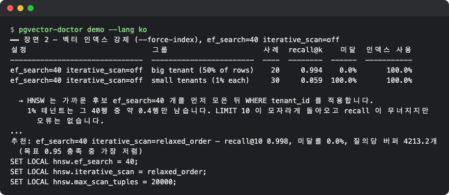
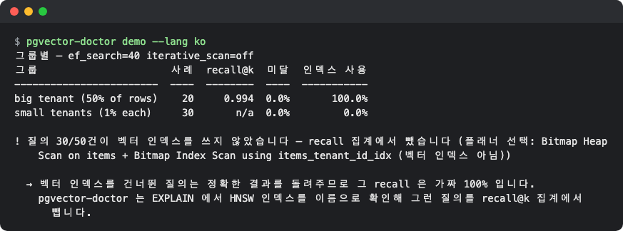
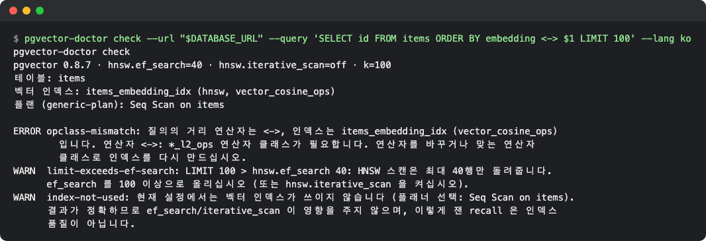
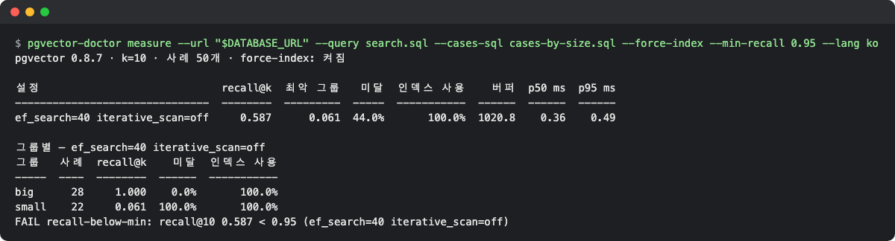
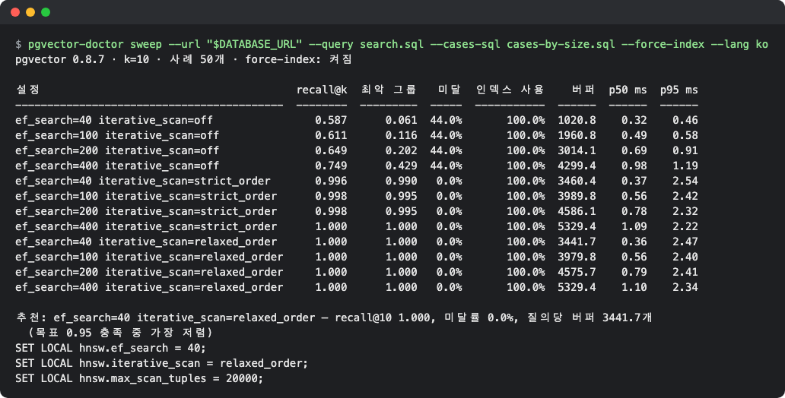

# pgvector-doctor

[English](README.md) | **한국어**

`WHERE tenant_id = $2 ORDER BY embedding <=> $1 LIMIT 10` 같은 필터 걸린 벡터 검색이 **오류 없이 결과를 덜 돌려줘도** 알아채기 어렵습니다. 이 도구는 내 SQL 그대로 정확 검색과 비교해 숫자로 보여 주고, 목표 recall 을 가장 싸게 맞추는 설정(붙여 넣을 `SET LOCAL` 문 포함)을 골라 줍니다.


*연습용 목(mock) 모드 `npm start` 의 일부. 필터 값이 작은 테넌트(전체의 1%)는 recall 0.059, 100% 가 LIMIT 미달. 반복 스캔(iterative scan)을 켠 설정이 추천됩니다.*

## 이런 분께
- Postgres + pgvector 로 RAG·추천 검색을 만들었고, `WHERE` 필터(테넌트·카테고리·권한)가 붙은 검색에서 결과가 모자란 적이 있는 분
- `hnsw.ef_search` 나 `hnsw.iterative_scan`(pgvector 0.8.0 이상)을 어떻게 잡을지 감이 아니라 숫자로 정하고 싶은 분
- 인덱스·데이터 분포가 바뀐 뒤 검색 품질이 떨어지지 않았는지 CI 에서 막고 싶은 분

## 설치

Node.js 22.12 이상이 필요합니다(로컬 확인은 v26.13.0, 22.12.0 과 24 는 레포의 CI 매트릭스로 확인). 순수 JS·WASM 이라 리눅스에서도 추가 시스템 패키지가 필요 없습니다.

```bash
# Node 가 없다면 (macOS): brew install node   /   (Linux·Windows: https://nodejs.org/en/download)
git clone https://github.com/LeeGyeongPil/pgvector-doctor.git
cd pgvector-doctor
npm ci
npm run build        # dist/ 생성 — 이후 명령은 node dist/cli.js 로 실행
```

아직 npm 에 게시하지 않았습니다. **게시 후**에는 설치 없이 `npx pgvector-doctor <명령>` 으로 같은 명령을 쓸 수 있습니다(아래 예의 `node dist/cli.js` 를 `npx pgvector-doctor` 로 바꾸면 됩니다).

앱 코드에서 라이브러리로 쓰려면(게시 전) 레포에서 묶음 파일을 만들어 내 프로젝트에 설치합니다.

```bash
npm pack --ignore-scripts         # pgvector-doctor-0.3.0.tgz 생성
cd /내/프로젝트
npm install /경로/pgvector-doctor-0.3.0.tgz
```

## 빠르게 시작하기

서버도 DB 도 필요 없는 **연습용 목(mock) 모드**입니다. 프로세스 안에서 PGlite(진짜 PostgreSQL 18 + pgvector 를 WASM 으로 실행)에 시드 고정 합성 데이터를 만들고 세 장면을 보여 줍니다(약 5초).

```bash
npm start
```

화면은 영어 또는 한국어로 나옵니다. 영어 로캘이면 영어, 한국어 로캘(`LANG=ko_KR.UTF-8`)이면 한국어입니다. 하나로 고정하려면 `--lang en` 또는 `--lang ko` 를 붙입니다(예: `npm start -- --lang ko`). 자세한 내용은 아래 "화면 언어"를 보세요. 이 문서의 출력 예시는 영어로 실었고, 한국어 화면은 스크린샷과 "화면 언어"의 예시로 보여 드립니다.

처음 부분입니다.

```text
pgvector-doctor demo — practice (mock) mode
  In-process PGlite (real PostgreSQL + pgvector compiled to WASM) with seeded synthetic data.
  recall / LIMIT-short / index-use results are real; latency numbers are WASM numbers, not your server.

PostgreSQL 18.6 · pgvector 0.8.7
table items: 5000 rows, 32-dim, HNSW (vector_cosine_ops) + btree on tenant_id; tenant 0 = 50% of rows, tenants 1..50 = 1% each
query: SELECT id FROM items WHERE tenant_id = $2 ORDER BY embedding <=> $1 LIMIT 10
cases: 20 vectors from the big tenant + 1 from each of 30 small tenants (self row excluded)
```

- 큰 테넌트 1개가 행의 50%, 작은 테넌트 50개가 각 1% 를 가진 5,000행 테이블입니다.
- recall·LIMIT 미달·인덱스 사용 판정은 **실제 PostgreSQL 이 계산한 진짜 값**입니다. 다만 지연(ms) 숫자는 WASM 에서 잰 값이라 내 서버와 다릅니다. 실제 모드와의 차이는 아래 "실제 DB 에 쓰기"를 보세요.
- recall 소수 셋째 자리는 HNSW 내부 난수 때문에 실행마다 조금 달라질 수 있습니다(0.994 가 1.000 이 되는 정도). 읽은 버퍼 수(buffers)도 소수·일의 자리가 조금 달라질 수 있습니다. 큰 흐름(작은 테넌트 0.06 부근, 추천이 반복 스캔)은 같습니다.

### 장면 1 — 플래너에 맡기면 "가짜 만점"이 나옵니다


*작은 테넌트 30건은 벡터 인덱스를 타지 않아(인덱스 사용 0.0%) recall 이 n/a 입니다.*

```text
by group — ef_search=40 iterative_scan=off
group                     cases  recall@k  short  index used
------------------------  -----  --------  -----  ----------
big tenant (50% of rows)     20     0.994   0.0%      100.0%
small tenants (1% each)      30       n/a   0.0%        0.0%

! index not used for 30/50 queries — recall not counted (planner chose Bitmap Heap Scan on items + Bitmap Index Scan using items_tenant_id_idx (not a vector index))
```
위 `! index not used` 경고가 핵심입니다. 플래너가 작은 테넌트에는 `tenant_id` 인덱스를 골라 **정확 결과**를 내므로 recall 이 1.0 처럼 보이지만, HNSW 품질이 아닙니다. pgvector-doctor 는 EXPLAIN 에서 노드의 인덱스 이름을 카탈로그의 hnsw/ivfflat 인덱스와 맞춰 보고, 벡터 인덱스를 타지 않은 질의는 recall 에서 뺍니다(n/a).

### 장면 2 — 인덱스를 강제로 타게 하면 결과가 사라집니다

`--force-index`(측정 전용)로 벡터 인덱스를 타게 하면 큰 테넌트는 0.994, 작은 테넌트는 0.059 이고 LIMIT 10 이 **전부** 모자랍니다.

```text
━━ Scene 2 — force the vector index (--force-index), ef_search=40 iterative_scan=off
config                           group                     cases  recall@k   short  index used
-------------------------------  ------------------------  -----  --------  ------  ----------
ef_search=40 iterative_scan=off  big tenant (50% of rows)     20     0.994    0.0%      100.0%
ef_search=40 iterative_scan=off  small tenants (1% each)      30     0.059  100.0%      100.0%
```

HNSW 는 후보를 `ef_search`(기본 40)개 먼저 모은 뒤 `WHERE` 로 거릅니다. 전체의 1% 인 테넌트의 행은 후보 40개 중 평균 0.4개뿐입니다.

### 장면 3 — 가장 싼 설정 고르기

`ef_search` 와 `iterative_scan` 을 조합해 재고, 목표 recall@10 0.95 를 맞추는 조합 중 **읽은 페이지(buffers)가 가장 적은 것**을 추천합니다.

```text
━━ Scene 3 — sweep ef_search × iterative_scan and pick the cheapest config that meets recall@10 >= 0.95
config                                      recall@k  worst group  short  index used  buffers  p50 ms  p95 ms
------------------------------------------  --------  -----------  -----  ----------  -------  ------  ------
ef_search=40 iterative_scan=off                0.433        0.059  60.0%      100.0%   1021.4    0.24    0.28
ef_search=100 iterative_scan=off               0.464        0.107  60.0%      100.0%   1966.5    0.40    0.46
ef_search=200 iterative_scan=off               0.516        0.193  60.0%      100.0%   3034.5    0.61    0.66
ef_search=400 iterative_scan=off               0.689        0.481  58.0%      100.0%   4352.6    0.91    0.98
ef_search=40 iterative_scan=strict_order       0.993        0.993   0.0%      100.0%   4218.8    1.61    2.30
ef_search=100 iterative_scan=strict_order      0.998        0.996   0.0%      100.0%   4618.3    1.58    2.19
ef_search=200 iterative_scan=strict_order      1.000        1.000   0.0%      100.0%   5070.8    1.50    2.16
ef_search=400 iterative_scan=strict_order      1.000        1.000   0.0%      100.0%   5624.5    1.43    2.11
ef_search=40 iterative_scan=relaxed_order      0.998        0.994   0.0%      100.0%   4208.1    1.57    2.22
ef_search=100 iterative_scan=relaxed_order     1.000        1.000   0.0%      100.0%   4614.4    1.57    2.17
ef_search=200 iterative_scan=relaxed_order     1.000        1.000   0.0%      100.0%   5071.0    1.48    2.16
ef_search=400 iterative_scan=relaxed_order     1.000        1.000   0.0%      100.0%   5624.5    1.40    2.11
```

`ef_search` 만 400 으로 10배 올려도 recall 은 0.689 이고 버퍼는 4352.6 으로 반복 스캔(4208 안팎)보다 더 비쌉니다. 반복 스캔을 켜야 결과가 채워집니다. 마지막 추천 부분입니다.

```text
Recommended: ef_search=40 iterative_scan=relaxed_order — recall@10 0.998, short 0.0%, 4208.1 buffers/query (cheapest meeting target 0.95)
SET LOCAL hnsw.ef_search = 40;
SET LOCAL hnsw.iterative_scan = relaxed_order;
SET LOCAL hnsw.max_scan_tuples = 20000;
```

추천 기준이 지연(ms)이 아니라 읽은 버퍼 수라서 기계 속도와 무관하게 거의 같은 추천이 나옵니다(buffers 값 자체는 HNSW 난수 때문에 조금 달라질 수 있습니다).

## 실제 DB 에 쓰기

실제 모드는 **내 Postgres 에 접속**해 질의마다 정확 검색(순차 스캔)을 한 번씩 더 돌립니다. 테이블이 크거나 DB 가 공유 자원이면 느릴 수 있고 부하도 줍니다. 운영 DB 대신 **복제본이나 스테이징 DB** 를 쓰고, 사례는 기본 50개로 제한됩니다. 질의마다 `statement_timeout` 이 적용됩니다(`--timeout`, 기본 30s). 접속 문자열은 `--url` 또는 `DATABASE_URL` 입니다.

모든 측정은 `BEGIN READ ONLY` 트랜잭션 안에서 `SET LOCAL` 만 씁니다. 데이터를 쓰지 않고 세션 설정도 남기지 않습니다.

아래 예시 출력은 demo 와 같은 합성 데이터(5,000행, tenant 0 = big)를 PGlite 소켓 서버로 띄우고 `pg` 드라이버로 접속해 얻은 값입니다. 내 DB 에서는 숫자가 다르고, 소수 셋째 자리는 실행마다 조금 달라집니다. 명령은 현재 폴더에 `search.sql`·`cases-by-size.sql` 이 있다고 가정합니다. 이 레포 루트에서 따라 하려면 `--query examples/search.sql` 처럼 경로를 붙이세요(`examples/cases.sql` 도 있습니다).

### 1) 내 검색 SQL 을 파일로

[`examples/search.sql`](examples/search.sql) 처럼 앱이 실제로 보내는 쿼리를 그대로 둡니다.

```sql
SELECT id
FROM items
WHERE tenant_id = $2
ORDER BY embedding <=> $1
LIMIT 10;
```
- 첫 열은 행 식별자(정확·근사 결과 비교에 씁니다), `$1` 은 질의 벡터, `$2…` 는 필터 값, `LIMIT` 은 필수입니다(`LIMIT $3` 처럼 변수면 `--k` 로 숫자를 줍니다).
- 쓰기 SQL 이 들어 있으면 읽기 전용 트랜잭션이 거부합니다.

### 2) 어떤 값으로 돌려 볼지 — 질의 사례 SQL

[`examples/cases.sql`](examples/cases.sql) 은 테이블에서 같은 표본 50건을 고릅니다(`ORDER BY md5(id::text)` 는 매번 같은 "무작위" 표본을 고르는 방법입니다).

```sql
SELECT embedding AS vector,
       tenant_id AS p2,
       id        AS self_id,
       'tenant ' || tenant_id AS "group"
FROM items
ORDER BY md5(id::text)
LIMIT 50;
```
- `vector` → `$1`, `p2…pN` → `$2…$N`
- `self_id`(선택): 질의 벡터를 뽑은 행. 정확·근사 결과에서 빼서 "자기 자신이 1위"로 recall 이 부풀지 않게 합니다.
- `group`(선택): 결과를 나눠 볼 이름. 없으면 `p2…` 값별로 나눕니다. 큰/작은 테넌트로 묶고 싶으면 아래처럼 쓰고 `cases-by-size.sql` 로 저장하세요.

```sql
SELECT embedding AS vector,
       tenant_id AS p2,
       id        AS self_id,
       CASE WHEN tenant_id = 0 THEN 'big' ELSE 'small' END AS "group"
FROM items
ORDER BY md5(id::text)
LIMIT 50;
```
- `--cases 파일.jsonl` 로 같은 필드를 JSON 줄로 줄 수도 있습니다.

### 3) check — 설정 실수부터 찾기

```bash
node dist/cli.js check --url "$DATABASE_URL" --query 'SELECT id FROM items ORDER BY embedding <-> $1 LIMIT 100'; echo "[exit $?]"
```
```text
pgvector-doctor check
pgvector 0.8.7 · hnsw.ef_search=40 · hnsw.iterative_scan=off · k=100
tables: items
vector indexes: items_embedding_idx (hnsw, vector_cosine_ops)
plan (generic-plan): Seq Scan on items

ERROR opclass-mismatch: query uses <-> but the index is items_embedding_idx (vector_cosine_ops); <-> needs *_l2_ops. Change the operator or rebuild the index with the matching operator class.
WARN  limit-exceeds-ef-search: LIMIT 100 > hnsw.ef_search 40: an HNSW scan returns at most 40 rows. Raise ef_search to at least 100 or enable hnsw.iterative_scan.
WARN  index-not-used: with the current settings the vector index is not used (planner chose Seq Scan on items). Results are exact, so ef_search/iterative_scan have no effect here; recall measured this way is not index quality.
[exit 1]
```

*`<->`(L2) 연산자인데 인덱스는 코사인(`vector_cosine_ops`)이라 인덱스를 못 씁니다. LIMIT 100 은 `ef_search` 40 보다 커서 최대 40행만 돌아옵니다.*

- `ERROR` 가 있으면 종료 코드 1, `WARN` 만 있으면 0 입니다.
- 질의가 IVFFlat 인덱스를 쓰면 `check` 는 `WARN ivfflat-not-tuned` 를 내고, `measure`·`sweep` 은 표 위에 같은 경고 한 줄을 붙입니다. `hnsw.*` 설정은 효과가 없으니 `ivfflat.probes` 를 조정하세요.
- `check` 의 플랜 확인은 사례가 없으면 "평균 선택도의 일반 계획(generic plan)"을 씁니다. 특정 작은 필터 값의 실제 계획과 다를 수 있으니 `--cases-sql` 을 함께 주세요.

### 4) measure — 지금 설정의 품질

```bash
node dist/cli.js measure --url "$DATABASE_URL" --query search.sql --cases-sql cases-by-size.sql --force-index --min-recall 0.95; echo "[exit $?]"
```
```text
pgvector 0.8.7 · k=10 · 50 cases · force-index: on

config                           recall@k  worst group  short  index used  buffers  p50 ms  p95 ms
-------------------------------  --------  -----------  -----  ----------  -------  ------  ------
ef_search=40 iterative_scan=off     0.587        0.061  44.0%      100.0%   1021.9    0.36    0.55

by group — ef_search=40 iterative_scan=off
group  cases  recall@k   short  index used
-----  -----  --------  ------  ----------
big       28     1.000    0.0%      100.0%
small     22     0.061  100.0%      100.0%
FAIL recall-below-min: recall@10 0.587 < 0.95 (ef_search=40 iterative_scan=off)
[exit 1]
```

*평균(0.587)은 애매해 보여도 그룹별로 나누면 small 이 0.061 로 무너져 있음이 드러납니다. `--min-recall` 에 못 미치면 종료 코드 1 입니다.*

표 읽는 법(아래 표는 4) measure 결과를 읽는 방법이며, 5)·6) 도 같은 열을 씁니다)

| 열 | 뜻 |
|---|---|
| `recall@k` | 정확 검색 상위 k개 중 근사 검색이 같은 행을 몇 %(0~1) 돌려줬나(집합 기준). **벡터 인덱스를 탄 질의만** 평균냅니다 |
| `worst group` | 그룹 중 가장 낮은 recall. 평균은 괜찮은데 작은 그룹만 망가진 경우를 한 줄에서 보여 줍니다 |
| `short` | 정확 검색보다 적은 행을 돌려준(LIMIT 미달) 질의 비율 |
| `index used` | 벡터 인덱스(hnsw·ivfflat)를 실제로 탄 질의 비율 |
| `buffers` | 질의당 읽은 페이지 수(shared hit + read 평균). 추천의 비용 기준 |
| `p50 ms` / `p95 ms` | 지연 백분위(참고용. 서버 상태에 따라 흔들립니다) |

### 5) sweep — 가장 싼 설정 추천

```bash
node dist/cli.js sweep --url "$DATABASE_URL" --query search.sql --cases-sql cases-by-size.sql --force-index
```
```text
pgvector 0.8.7 · k=10 · 50 cases · force-index: on

config                                      recall@k  worst group  short  index used  buffers  p50 ms  p95 ms
------------------------------------------  --------  -----------  -----  ----------  -------  ------  ------
ef_search=40 iterative_scan=off                0.587        0.061  44.0%      100.0%   1021.9    0.32    0.43
ef_search=100 iterative_scan=off               0.611        0.116  44.0%      100.0%   1962.0    0.47    0.60
ef_search=200 iterative_scan=off               0.649        0.202  44.0%      100.0%   3014.6    0.68    0.94
ef_search=400 iterative_scan=off               0.749        0.429  44.0%      100.0%   4299.2    0.95    1.27
ef_search=40 iterative_scan=strict_order       0.996        0.990   0.0%      100.0%   3462.6    0.40    2.43
ef_search=100 iterative_scan=strict_order      0.998        0.995   0.0%      100.0%   3990.6    0.56    2.33
ef_search=200 iterative_scan=strict_order      0.998        0.995   0.0%      100.0%   4586.8    0.77    2.23
ef_search=400 iterative_scan=strict_order      1.000        1.000   0.0%      100.0%   5329.4    1.09    2.09
ef_search=40 iterative_scan=relaxed_order      1.000        1.000   0.0%      100.0%   3443.9    0.37    2.25
ef_search=100 iterative_scan=relaxed_order     1.000        1.000   0.0%      100.0%   3980.7    0.54    2.19
ef_search=200 iterative_scan=relaxed_order     1.000        1.000   0.0%      100.0%   4576.5    0.80    2.24
ef_search=400 iterative_scan=relaxed_order     1.000        1.000   0.0%      100.0%   5329.5    1.10    2.25

Recommended: ef_search=40 iterative_scan=relaxed_order — recall@10 1.000, short 0.0%, 3443.9 buffers/query (cheapest meeting target 0.95)
SET LOCAL hnsw.ef_search = 40;
SET LOCAL hnsw.iterative_scan = relaxed_order;
SET LOCAL hnsw.max_scan_tuples = 20000;
  note: Run the SET LOCAL lines inside the same transaction (same connection) as the search query; with a pool, BEGIN … COMMIT around both.
  note: relaxed_order may return rows slightly out of distance order. If order matters, wrap the query in WITH r AS MATERIALIZED (…) and ORDER BY distance + 0 outside.
```

*기본 격자는 `ef_search` 40·100·200·400 × `iterative_scan` off·strict_order·relaxed_order 의 12조합입니다.*

- 추천은 목표 recall(`--target`, 기본 0.95)과 LIMIT 미달 상한(`--max-short`, 기본 0)을 만족하고 **모든 질의가 벡터 인덱스를 탄** 조합 중 버퍼가 가장 적은 것입니다. 없으면 `no-config-meets-target` 으로 종료 코드 1 입니다.
- 질의가 IVFFlat 인덱스를 쓰면 표 위에 경고 한 줄이 붙습니다(`measure` 와 같음). 이 경우 `ef_search` 격자는 recall 을 바꾸지 못하니 `ivfflat.probes` 를 직접 조정하세요(sweep 은 아직 probes 를 조정하지 않습니다).
- `--target-scope group` 이면 평균이 아니라 **모든 그룹의 최저 recall** 이 목표를 넘어야 합니다.
- 추천된 `SET LOCAL` 줄은 **검색 쿼리와 같은 트랜잭션·같은 연결**에서 실행하세요. 커넥션 풀을 쓰면 `BEGIN … COMMIT` 으로 감쌉니다.
- `relaxed_order` 는 결과 순서가 거리순에서 조금 어긋날 수 있습니다. 순서가 중요하면 `WITH r AS MATERIALIZED (…)` 로 감싸고 바깥에서 `ORDER BY distance + 0` 하세요.

### 6) CI 에서 쓰기

```bash
node dist/cli.js measure --url "$DATABASE_URL" --query search.sql --cases-sql cases-by-size.sql \
  --force-index --iterative relaxed_order --min-recall 0.95 --format md --out recall.md
```
```text
pgvector 0.8.7 · k=10 · 50 cases · force-index: on

config                                     recall@k  worst group  short  index used  buffers  p50 ms  p95 ms
-----------------------------------------  --------  -----------  -----  ----------  -------  ------  ------
ef_search=40 iterative_scan=relaxed_order     1.000        1.000   0.0%      100.0%   3443.9    0.40    2.30

by group — ef_search=40 iterative_scan=relaxed_order
group  cases  recall@k  short  index used
-----  -----  --------  -----  ----------
big       28     1.000   0.0%      100.0%
small     22     1.000   0.0%      100.0%

PASS quality gate
```
`recall.md` 에는 표가 들어갑니다(시각·절대 경로 없음, PR 코멘트에 붙이기 좋습니다).

```text
## pgvector-doctor measure

- pgvector 0.8.7 · k=10 · 50 cases · force-index: on

| config | recall@k | worst group | short | index used | buffers | p50 ms | p95 ms |
|---|---:|---:|---:|---:|---:|---:|---:|
| ef_search=40 iterative_scan=relaxed_order | 1.000 | 1.000 | 0.0% | 100.0% | 3443.9 | 0.40 | 2.30 |

### by group — ef_search=40 iterative_scan=relaxed_order
| group | cases | recall@k | short | index used |
|---|---:|---:|---:|---:|
| big | 28 | 1.000 | 0.0% | 100.0% |
| small | 22 | 1.000 | 0.0% | 100.0% |

**PASS** quality gate
```

종료 코드

| 코드 | 뜻 |
|---|---|
| 0 | 통과 (`check` 는 error 진단 없음) |
| 1 | 품질 게이트 실패(`recall-below-min`, `index-not-used`) / 추천할 설정 없음 / `check` 가 error 진단 |
| 2 | 사용법·접속·SQL 오류 (예: 쓰기 SQL, 숫자가 아닌 `--ef`) |

## 사용법

| 명령·옵션 | 하는 일 | 예 |
|---|---|---|
| `demo` | 서버 없이 연습용 목 모드 3장면 | `node dist/cli.js demo` |
| `check` | pgvector 버전·인덱스·연산자·현재 설정에서 인덱스 사용 여부·`LIMIT > ef_search` 진단 | `check --query search.sql --cases-sql cases.sql` |
| `measure` | 지금 설정(또는 `--ef`·`--iterative` 로 고른 하나)의 recall·미달·버퍼·지연을 그룹별로 | `measure --query search.sql --cases-sql cases.sql` |
| `sweep` | 격자를 재서 가장 싼 설정과 `SET LOCAL` 추천 | `sweep --query search.sql --cases-sql cases.sql --force-index` |
| `--url` | 접속 문자열(없으면 `DATABASE_URL`) | `--url "$DATABASE_URL"` |
| `--force-index` | **측정 전용**: seq/bitmap scan·sort 를 꺼서 벡터 인덱스를 타게 함 | `--force-index` |
| `--ef`, `--iterative`, `--max-scan-tuples` | 잴 `hnsw.*` 값(쉼표로 여러 개는 sweep) | `--ef 100,200 --iterative off,relaxed_order` |
| `--min-recall`, `--min-index-use` | 게이트. `--min-recall` 을 주면 인덱스 사용 100% 도 함께 요구 | `--min-recall 0.95` |
| `--target`, `--target-scope`, `--max-short` | sweep 추천 조건 | `--target 0.9 --target-scope group` |
| `--max-cases`, `--timeout`, `--k` | 사례 수 상한(50)·질의 제한 시간(30s)·LIMIT 이 변수일 때 k | `--max-cases 100` |
| `--format`, `--out` | `table`·`json`·`md`, 파일 저장 | `--format md --out recall.md` |
| `--lang` | 화면 언어 `en` 또는 `ko` (아래 "화면 언어" 참고) | `--lang ko` |

전체 도움말은 `node dist/cli.js --help` 입니다.

### 화면 언어

도움말, 사용법 오류, 표와 Markdown 보고서, `demo` 문구, 진행 표시, `FAIL` 뒤의 설명문이 영어 또는 한국어로 나옵니다. 언어는 아래 순서로 정하며, 먼저 설정된 것이 이깁니다.

1. 명령줄의 `--lang en|ko`
2. 환경변수 `PGVECTOR_DOCTOR_LANG=en|ko`
3. `LC_ALL`, 그다음 `LC_MESSAGES`, 그다음 `LANG`: 처음 비어 있지 않은 값이 `ko` 로 시작할 때(`ko_KR.UTF-8` 등)만 한국어입니다. `C`·`POSIX`·값 없음을 포함해 그 밖은 영어입니다.

```bash
node dist/cli.js demo --lang ko                 # 환경과 관계없이 한국어
PGVECTOR_DOCTOR_LANG=en node dist/cli.js demo   # 한국어 로캘에서도 영어
LANG=ko_KR.UTF-8 node dist/cli.js --help        # 로캘에 따라 한국어
node dist/cli.js --lang fr check                # error: --lang must be en or ko (got "fr"), 종료 코드 2 (한국어 로캘에서는 이 메시지도 한국어로 나옵니다)
```

한국어 화면의 예(`node dist/cli.js demo --lang ko` 의 일부)입니다.

```text
pgvector-doctor demo — 연습용(목) 모드
  프로세스 안 PGlite(WASM 으로 컴파일한 진짜 PostgreSQL + pgvector)와 시드를 고정한 합성 데이터를 씁니다.
  recall / LIMIT 미달 / 인덱스 사용 결과는 진짜이고, 지연 시간은 WASM 기준이라 내 서버와 다릅니다.

PostgreSQL 18.6 · pgvector 0.8.7
items 테이블: 5000행, 32차원, HNSW (vector_cosine_ops) + tenant_id btree. 테넌트 0 = 전체 행의 50%, 테넌트 1..50 = 각각 1%
질의: SELECT id FROM items WHERE tenant_id = $2 ORDER BY embedding <=> $1 LIMIT 10
사례: 큰 테넌트 벡터 20개 + 작은 테넌트 30곳에서 1개씩 (자기 행 제외)
```

두 언어 모두 영어 그대로 나오는 것들이 있어, 스크립트가 기대어도 됩니다.

- `--format json` 출력은 `en` 과 `ko` 에서 바이트 단위로 같습니다(실행마다 달라지는 지연 숫자 제외). 진단·게이트 실패·추천 사유 안의 문장도 영어 그대로입니다.
- 규칙 ID(`index-not-used`, `recall-below-min`, `no-config-meets-target`, 진단 코드), 태그 `PASS`·`FAIL`·`ERROR`·`WARN`·`INFO`·`OK`, 오류 줄 머리의 `error:`
- `SET LOCAL …` 문, `ef_search=40 iterative_scan=off` 같은 설정 라벨, `Seq Scan on items` 같은 EXPLAIN 노드 이름
- Postgres 서버·드라이버 오류의 원문(그 앞의 접두어만 번역됩니다. 예: `접속하지 못했습니다:`)
- demo 의 데이터: `big tenant (50% of rows)` 같은 그룹 이름과 질의 SQL

출력 문구를 `grep` 하는 스크립트라면 `--lang en` 을 붙이거나 `PGVECTOR_DOCTOR_LANG=en` 을 설정해 두세요. 로캘에 따라 문구가 바뀌지 않습니다.

### 가짜 만점 확인 — 인덱스를 못 탄 채로 게이트를 걸면

`--force-index` 없이 `--min-recall` 만 주면 플래너가 인덱스를 안 탄 질의 때문에 게이트가 `index-not-used` 로 실패합니다. recall 1.0 으로 통과시켜 주지 않습니다.

```bash
node dist/cli.js measure --url "$DATABASE_URL" --query search.sql --cases-sql cases-by-size.sql --min-recall 0.95; echo "[exit $?]"
```
```text
pgvector 0.8.7 · k=10 · 50 cases · force-index: off

config                           recall@k  worst group  short  index used  buffers  p50 ms  p95 ms
-------------------------------  --------  -----------  -----  ----------  -------  ------  ------
ef_search=40 iterative_scan=off     1.000          n/a   0.0%       56.0%    593.5    0.32    0.40

by group — ef_search=40 iterative_scan=off
group  cases  recall@k  short  index used
-----  -----  --------  -----  ----------
big       28     1.000   0.0%      100.0%
small     22       n/a   0.0%        0.0%

! index not used for 22/50 queries — recall not counted (planner chose Bitmap Heap Scan on items + Bitmap Index Scan using items_tenant_id_idx (not a vector index))
FAIL index-not-used: 56.0% of queries used the vector index (< 100.0%); recall from exact scans is not index quality (ef_search=40 iterative_scan=off). Use --force-index to measure the index, or --min-index-use 0 to accept.
[exit 1]
```

### 잘못된 값은 접속하기 전에 거부

```bash
node dist/cli.js measure --url "$DATABASE_URL" --query search.sql --cases-sql cases.sql --ef '40; DROP TABLE items'; echo "[exit $?]"
```
```text
error: --ef: "40; DROP TABLE items" is not a whole number
[exit 2]
```

## 라이브러리로 쓰기

CLI 가 쓰는 함수가 그대로 export 됩니다. 필요한 패키지는 `pgvector-doctor` 하나입니다(`pg` 드라이버를 의존성으로 함께 설치합니다). 위 "앱 코드에서 라이브러리로" 의 `npm install` 을 먼저 하세요.

ESM (`recall.mjs`):

```js
import { readFileSync } from 'node:fs';
import { connect, parseTemplate, casesFromSql, sweep, setLocalStatements } from 'pgvector-doctor';

const { db, close } = await connect(process.env.DATABASE_URL);
try {
  const template = parseTemplate(readFileSync('search.sql', 'utf8'));
  const cases = await casesFromSql(
    db,
    `SELECT embedding AS vector, tenant_id AS p2, id AS self_id,
            CASE WHEN tenant_id = 0 THEN 'big' ELSE 'small' END AS "group"
     FROM items ORDER BY md5(id::text) LIMIT 30`,
    template,
    30,
  );
  const result = await sweep(db, { template, cases, forceIndex: true, target: 0.95 });
  const best = result.recommendation.choice;
  if (!best) throw new Error('no setting reaches the target');
  console.log(best.label, 'recall', best.summary.recall.toFixed(3));
  console.log(setLocalStatements(best.config).join('\n'));
} finally {
  await close();
}
```
CommonJS 도 `const { connect, … } = require('pgvector-doctor')` 로 같게 동작합니다(Node 22.12 이상의 `require(esm)`). 예제의 top-level `await` 는 ESM 에서만 되므로 CommonJS 에서는 `(async () => { … })();` 로 감싸세요. 같은 내용을 `type: module` 프로젝트(`.mjs`)와 CommonJS 프로젝트(`.cjs`)에서 각각 실행해 아래 출력을 확인했습니다.

```text
ef_search=40 iterative_scan=relaxed_order recall 1.000
SET LOCAL hnsw.ef_search = 40;
SET LOCAL hnsw.iterative_scan = relaxed_order;
SET LOCAL hnsw.max_scan_tuples = 20000;
```

`connect` 대신 `query(text, params)` 를 가진 객체(`Queryable`)면 무엇이든 넘길 수 있습니다. PGlite 용 `pgliteQueryable(pglite)` 도 export 합니다. 직접 만든 `Queryable` 은 문장마다 확장 프로토콜(파라미터 배열을 항상 넘기는 prepared 실행)을 써야 "안전성" 2번이 유지됩니다.

## 설정

| 이름 | 용도 | 기본값 |
|---|---|---|
| `DATABASE_URL` / `--url` | 측정할 Postgres 접속 문자열. [`.env.example`](.env.example) 참고(`.env` 는 자동으로 읽지 않습니다. 셸에서 `export` 하세요) | 없음 |
| `--max-cases` | 질의 사례 수 상한 | 50 |
| `--timeout` | 질의마다 `statement_timeout` | 30s |
| `--target` | sweep 목표 recall | 0.95 |
| `--lang` / `PGVECTOR_DOCTOR_LANG` | 화면 언어 `en` 또는 `ko`. 순서: `--lang`, `PGVECTOR_DOCTOR_LANG`, `LC_ALL`, `LC_MESSAGES`, `LANG` | 로캘이 `ko` 로 시작하지 않으면 영어 |

키·계정은 필요 없습니다. 연습용 목 모드(`demo`)와 테스트는 전부 프로세스 안 PGlite 로 돌아 네트워크가 필요 없습니다.

## 동작 원리

```mermaid
flowchart LR
  Q[내 검색 SQL<br/>search.sql] --> M[measure]
  C[질의 사례<br/>cases.sql] --> M
  M -->|정확 기준값| E[인덱스 스캔 끄고<br/>정확 검색]
  M -->|조합마다| A[SET LOCAL 설정 후<br/>근사 검색 + EXPLAIN]
  E --> R[recall@k·LIMIT 미달]
  A --> R
  A --> I{벡터 인덱스를<br/>탔나?}
  I -->|아니오| N[recall 에서 제외 n/a]
  I -->|예| R
  R --> S[sweep: 가장 싼 조합 추천]
```

1. 사례 하나마다 인덱스 스캔을 끈 **정확 검색** 결과를 기준값으로 한 번 얻습니다.
2. 설정 조합마다 `SET LOCAL` 로 `hnsw.*` 값을 바꿔 같은 질의를 돌리고 `EXPLAIN (ANALYZE, BUFFERS)` 를 함께 받습니다.
3. 플랜 노드의 인덱스 이름이 카탈로그의 hnsw/ivfflat 인덱스일 때만 "벡터 인덱스 사용"으로 봅니다(btree 스캔은 제외). 안 탄 질의는 recall 에서 뺍니다.
4. 기준값과 비교해 recall@k·LIMIT 미달률을 필터 값(그룹)별로 계산합니다.
5. sweep 은 목표를 넘는 조합 중 읽은 버퍼가 가장 적은 것을 고르고 `SET LOCAL` 문을 출력합니다.

모든 단계는 `BEGIN READ ONLY` 트랜잭션 안입니다. `--force-index` 는 측정을 위해 `enable_seqscan`·`enable_bitmapscan`·`enable_sort` 를 `SET LOCAL` 로 끕니다(필터에 `tenant_id` btree 가 있으면 플래너가 그쪽을 골라 벡터 인덱스를 잴 수 없기 때문). **운영에서 이 설정을 강제하는 것은 권장하지 않습니다.**

## 안전성

내 DB 에 붙는 도구라 쓰기를 못 하게 세 겹으로 막습니다.

1. **읽기 전용 트랜잭션**: 모든 측정은 `BEGIN READ ONLY` 안에서 하고 설정은 `SET LOCAL` 로만 바꿉니다. `INSERT`·`DELETE` 는 DB 가 거부합니다.
2. **문장 하나만 실행**: 모든 SQL 을 *확장 질의 프로토콜*(문장 하나씩 준비해서 실행하는 방식)으로 보냅니다. 그래서 `…; COMMIT; DELETE …` 처럼 문장을 이어 붙여 읽기 전용 트랜잭션을 벗어나려 해도 DB 가 `cannot insert multiple commands into a prepared statement` 로 거부합니다.
3. **템플릿 검사**: 검색 SQL 은 실행 전에 검사합니다. 검사기는 `E'…'` 문자열, 달러 인용(`$…$`), 중첩 주석을 PostgreSQL 과 같게 읽어 문장이 둘 이상이면 종료 코드 2 로 거부합니다.

사례 없이 `check` 를 돌릴 때 필요한 일반 계획(generic plan)도 같은 보호 아래서 얻습니다. 읽기 전용 트랜잭션 안에서 `plan_cache_mode = force_generic_plan` 으로 `PREPARE` 한 뒤 `EXPLAIN EXECUTE` 하고 `DEALLOCATE` 합니다(PostgreSQL 12 이상). 파라미터 타입을 정할 수 없거나 플랜에 테이블이 없으면 `INFO plan-check-skipped` 로 알리고(종료 코드 0), 문법 오류·없는 테이블은 종료 코드 2 입니다.

접속 문자열은 `--url` 또는 `DATABASE_URL` 로만 받고 저장하지 않습니다. 취약점은 [SECURITY.md](SECURITY.md) 경로로 알려 주세요.

## 한계

- 클라이언트에서 재고 추천만 합니다. 인덱스를 만들거나 서버 설정을 바꾸지 않습니다.
- recall 은 정확 검색 대비 값이라 답변 품질(RAG 정답률)과는 다릅니다.
- HNSW(pgvector 0.8.0 이상의 `iterative_scan` 포함)만 다룹니다. IVFFlat 파라미터 조정, halfvec·sparsevec 전용 진단은 아직 없습니다. `check` 는 질의가 IVFFlat 을 쓰면 경고만 합니다.
- 사례 수가 적으면 recall 의 오차가 큽니다. 기본 사례 수보다 늘려 보세요.
- `standard_conforming_strings = off` 서버에서는 검사기의 판정이 서버와 다를 수 있습니다. 실행은 위 2번(프로토콜)이 막습니다.
- `demo` 끝에 나오는 "Try it on your database" 안내는 `npx pgvector-doctor …` 로 적혀 있지만 아직 npm 에 게시하지 않았으므로 지금은 `node dist/cli.js …` 로 바꿔 치세요. 그 안내의 measure 줄은 `--force-index` 없이 `--min-recall` 을 쓰므로, 필터 쿼리에서는 인덱스를 못 탄 것으로 판정돼 실패할 수 있습니다(아래 "가짜 만점 확인" 참고).
- 연습용 목 모드의 지연(ms)은 WASM 값이고 recall 소수 셋째 자리는 실행마다 조금 달라집니다. 실제 Postgres 서버(pgvector 이미지)에 직접 붙이는 경로는 이 문서를 쓰는 환경에서 확인하지 못했고, `pg` 드라이버 경로는 PGlite 소켓 서버로 확인했습니다.

## 언제 쓰나
- 이럴 때: 필터가 걸린 pgvector HNSW 검색의 recall·결과 부족을 내 SQL·내 데이터로 재고, `ef_search`/`iterative_scan` 값을 정하거나 CI 에서 회귀를 막을 때.
- 이 도구의 범위: 클라이언트에서 읽기 전용으로 재고 추천만 합니다. 인덱스를 만들거나 설정을 바꾸지 않고, IVFFlat 파라미터 조정·halfvec/sparsevec 전용 진단은 아직 없습니다(`check` 는 질의가 IVFFlat 을 쓰면 경고만 합니다). 이 도구의 recall 은 정확 검색 대비 값이며 답변 품질(RAG 정답률)을 재지는 않습니다.
- 이럴 땐 다른 도구: 표준 데이터셋으로 벡터 DB 성능을 비교하려면 [VectorDBBench](https://github.com/zilliztech/VectorDBBench), 인덱스·확장 사용법은 [pgvector 공식 문서](https://github.com/pgvector/pgvector).

## 자주 겪는 문제

| 증상 | 원인 | 해결 |
|---|---|---|
| recall 이 1.000 인데 `index used` 가 낮거나 `! index not used …` 가 나옴 | 플래너가 순차 스캔·`tenant_id` 인덱스를 골라 정확 결과가 나옴(인덱스 미사용, "가짜 만점") | 정상 동작입니다. 도구가 그 질의를 recall 에서 뺍니다. 인덱스 품질을 재려면 `--force-index`, 게이트는 `--min-index-use 0` 을 주지 않는 한 `index-not-used` 로 실패합니다 |
| `FAIL index-not-used: … % of queries used the vector index` (종료 코드 1) | 위와 같음 + `--min-recall` 게이트 | `--force-index` 를 추가해 다시 측정 |
| 결과 행 수가 LIMIT 보다 적음(`short` 가 높음) | 필터 후처리: `ef_search` 후보 중 필터를 통과한 행만 남음 | `sweep` 으로 `iterative_scan`(pgvector 0.8.0 이상)을 켜는 설정을 확인 |
| `WARN pgvector-too-old` 같은 경고, `iterative_scan` 열이 없음 | pgvector 0.8.0 미만은 `hnsw.iterative_scan` 이 없음 | pgvector 를 올리거나 `ef_search` 만 비교 |
| `sweep` 의 모든 조합 recall 이 같거나 `no-config-meets-target` | 질의가 IVFFlat 인덱스를 써서 `hnsw.*` 설정이 효과 없음(`WARN ivfflat-not-tuned`) | 이 도구는 IVFFlat 을 조정하지 않습니다. `ivfflat.probes` 는 도구 밖에서 `ALTER DATABASE … SET ivfflat.probes = N` 또는 `ALTER ROLE … SET ivfflat.probes = N` 으로 설정(새 연결부터 적용되며, 애플리케이션 세션에서만 바꾼 값은 도구의 연결에 보이지 않음)한 뒤 `measure` 를 다시 실행 |
| `ERROR opclass-mismatch` | 쿼리의 거리 연산자(`<->`·`<=>`·`<#>`)와 인덱스의 연산자 클래스(`*_l2_ops`·`*_cosine_ops`·`*_ip_ops`)가 다름 | 쿼리 연산자를 바꾸거나 인덱스를 맞게 다시 만들기 |
| Docker·서버가 없어서 실제 모드를 못 돌림 | 실제 모드는 접속할 Postgres(pgvector 확장 설치)가 필요 | `npm start`(`demo`)는 Docker 없이 PGlite 로 돕니다. 연습은 그걸로, 진단은 복제본·스테이징 DB 로 |
| 접속 단계에서 오래 멈춤 | 접속 대기 최대 30초, 큰 테이블에서 정확 검색(순차 스캔)이 질의마다 한 번 | 오류가 아닙니다. 복제본을 쓰고 `--max-cases`·`--timeout` 을 줄이세요 |
| `error: --ef: "…" is not a whole number` (종료 코드 2) | `--ef`·`--iterative` 등은 숫자·허용 값만 받음(주입 방지) | 숫자만 쉼표로: `--ef 40,100` |
| `error: cannot execute SELECT in a read-only transaction` (종료 코드 2) | 검색 SQL 이 데이터를 쓰는 문장(CTE 안 `DELETE` 등) | 읽기 전용 `SELECT` 만 넣으세요 |
| Node 버전 관련 경고·`require(esm)` 오류 | Node 22.12 미만 | Node 22.12 이상으로 올리세요(`engines: >=22.12`) |
| `error: query template must be a single statement` (종료 코드 2) | 검색 SQL 에 문장이 둘 이상 | 하나의 `SELECT` 만 넣으세요 |
| `error: query uses LIMIT $3; pass --k` (종료 코드 2) | LIMIT 값이 변수라 k 를 알 수 없음 | `--k 10` 처럼 숫자를 주세요 |
| 출력이 뜻밖에 한국어(또는 영어)로 나옴 | `--lang` 과 `PGVECTOR_DOCTOR_LANG` 이 없으면 `LC_ALL` / `LC_MESSAGES` / `LANG` 을 따릅니다 | `--lang en` 또는 `--lang ko` 를 붙이거나 `PGVECTOR_DOCTOR_LANG` 을 설정하세요 |
| 출력을 `grep` 하는 스크립트가 한국어 환경에서 맞지 않게 됨 | 사람이 읽는 문구는 로캘을 따릅니다 | `--lang en` 으로 실행하거나 항상 영어인 `--format json` 을 파싱하세요 |

## 개발·기여

```bash
npm ci
npm test          # build + vitest 전체 테스트, 네트워크 불필요 (약 7초)
npm run check:pack  # 묶음 파일을 새 프로젝트에 설치해 bin·require·import·demo 확인
```
버그·제안은 이슈로 남겨 주세요. 변경 기록은 [CHANGELOG.md](CHANGELOG.md).

## 더 알아보기
- pgvector 공식 문서(HNSW·`hnsw.ef_search`·`hnsw.iterative_scan`·필터링): https://github.com/pgvector/pgvector (확인일 2026-11-11)
- 필터 검색에서 인덱스 사용·결과 부족 논의: https://github.com/pgvector/pgvector/issues/675, https://github.com/pgvector/pgvector/issues/684 (확인일 2026-11-11)

## 라이선스
MIT. 의존성: `pg`(MIT), `@electric-sql/pglite`·`@electric-sql/pglite-pgvector`(Apache-2.0). `demo` 의 데이터는 코드로 생성한 합성 데이터입니다.
