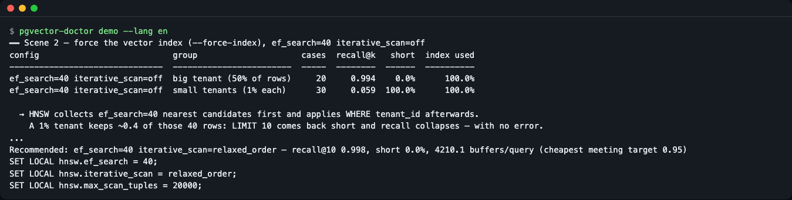
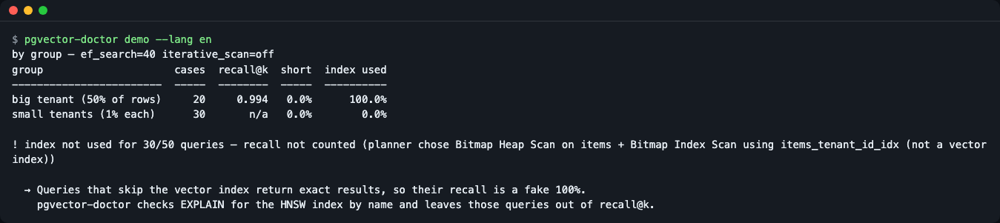
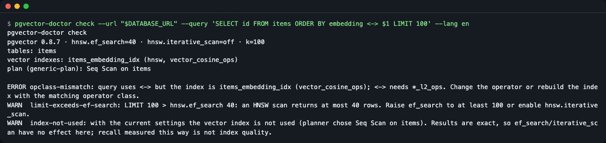
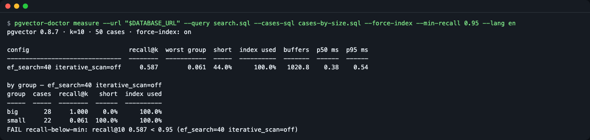
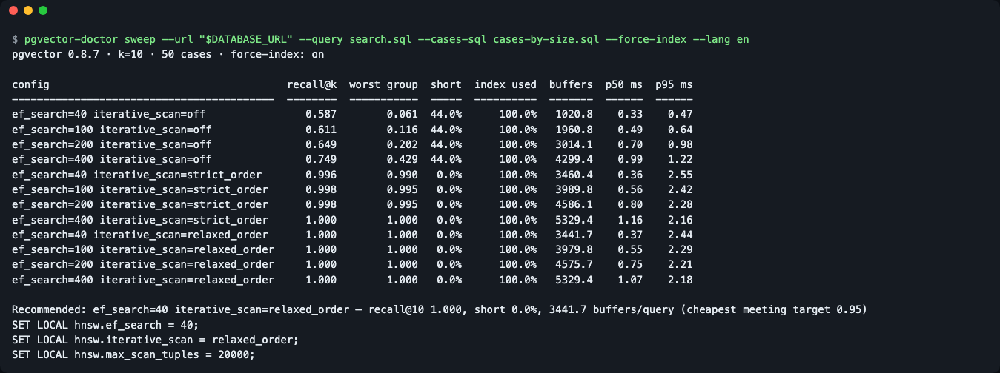
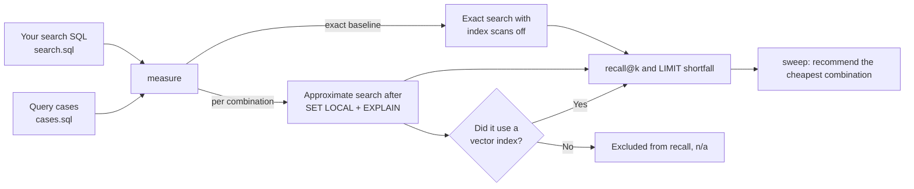

# pgvector-doctor

**English** | [한국어](README.ko.md)

pgvector-doctor measures how many of the true nearest neighbours your pgvector HNSW index actually returns (recall@k) for your own filtered SQL, broken down by filter value, and picks the cheapest `ef_search` / `iterative_scan` setting that reaches a recall target, including the `SET LOCAL` statements to paste in. A filtered search such as `WHERE tenant_id = $2 ORDER BY embedding <=> $1 LIMIT 10` can return fewer results without any error; this tool compares your SQL as written against exact search and shows the numbers. It also catches the "fake 100% recall" you get when the planner skips the vector index. Run `git clone https://github.com/LeeGyeongPil/pgvector-doctor.git && cd pgvector-doctor && npm ci && npm start` for a server-free practice (mock) demo; after the npm release, `npx pgvector-doctor demo`.


*Part of the practice mock mode `npm start`. A small tenant (1% of the rows) has recall 0.059, and 100% of its queries fall short of LIMIT. The setting with iterative scan turned on is recommended.*

## Who it's for
- You built RAG or recommendation search on Postgres + pgvector, and have seen searches with a `WHERE` filter (tenant, category, permission) return too few results
- You want to set `hnsw.ef_search` or `hnsw.iterative_scan` (pgvector 0.8.0 or later) by numbers, not by feel
- You want CI to block a drop in search quality after the index or data distribution changes

## Installation

Node.js 22.12 or later is required (checked locally on v26.13.0; 22.12.0 and 24 are checked by the repo's CI matrix). It is pure JS and WASM, so no extra system packages are needed even on Linux.

```bash
# If you do not have Node (macOS): brew install node   /   (Linux, Windows: https://nodejs.org/en/download)
git clone https://github.com/LeeGyeongPil/pgvector-doctor.git
cd pgvector-doctor
npm ci
npm run build        # Creates dist/ — run later commands as node dist/cli.js
```

It has not been published to npm yet. **After publishing**, you can use the same commands without installing, as `npx pgvector-doctor <command>` (replace `node dist/cli.js` in the examples below with `npx pgvector-doctor`).

To use it as a library in app code (before publishing), build the package file from the repo and install it into your project.

```bash
npm pack --ignore-scripts         # Creates pgvector-doctor-0.2.0.tgz
cd /my/project
npm install /path/to/pgvector-doctor-0.2.0.tgz
```

## Quick start

This is a **practice mock mode** that needs neither a server nor a DB. In-process, it builds seed-fixed synthetic data in PGlite (real PostgreSQL 18 + pgvector running as WASM) and shows three scenes (about 5 seconds).

```bash
npm start
```

The screen is in English or Korean. With an English locale you get English; with a Korean locale (`LANG=ko_KR.UTF-8`) you get Korean. To force one, add `--lang en` or `--lang ko` (for example `npm start -- --lang ko`); see "Screen language" below. The examples in this README are shown in English.

The first part:

```text
pgvector-doctor demo — practice (mock) mode
  In-process PGlite (real PostgreSQL + pgvector compiled to WASM) with seeded synthetic data.
  recall / LIMIT-short / index-use results are real; latency numbers are WASM numbers, not your server.

PostgreSQL 18.6 · pgvector 0.8.7
table items: 5000 rows, 32-dim, HNSW (vector_cosine_ops) + btree on tenant_id; tenant 0 = 50% of rows, tenants 1..50 = 1% each
query: SELECT id FROM items WHERE tenant_id = $2 ORDER BY embedding <=> $1 LIMIT 10
cases: 20 vectors from the big tenant + 1 from each of 30 small tenants (self row excluded)
```

- It is a 5,000-row table where one big tenant has 50% of the rows and 50 small tenants have 1% each.
- The recall, LIMIT-short and index-use verdicts are **real values computed by a real PostgreSQL**. However, the latency (ms) numbers are measured in WASM, so they differ from your server. For the differences from real mode, see "Using it on a real DB" below.
- The third decimal of recall can vary slightly from run to run because of HNSW's internal randomness (such as 0.994 becoming 1.000). The number of buffers read (buffers) can also vary slightly in the decimal and units place. The big picture (small tenants around 0.06, iterative scan recommended) stays the same.

### Scene 1 — Leave it to the planner and you get "fake perfect scores"


*The 30 small-tenant cases do not use the vector index (index used 0.0%), so recall is n/a.*

```text
by group — ef_search=40 iterative_scan=off
group                     cases  recall@k  short  index used
------------------------  -----  --------  -----  ----------
big tenant (50% of rows)     20     0.994   0.0%      100.0%
small tenants (1% each)      30       n/a   0.0%        0.0%

! index not used for 30/50 queries — recall not counted (planner chose Bitmap Heap Scan on items + Bitmap Index Scan using items_tenant_id_idx (not a vector index))
```
The `! index not used` warning above is the key. For small tenants the planner picks the `tenant_id` index and produces an **exact result**, so recall looks like 1.0, but that is not HNSW quality. pgvector-doctor matches the index name on the EXPLAIN node against the catalog's hnsw/ivfflat indexes, and leaves queries that did not use a vector index out of recall (n/a).

### Scene 2 — Force the index and results disappear

When `--force-index` (measurement only) makes it use the vector index, the big tenant is 0.994 and the small tenants are 0.059, and **every** query returns fewer than the LIMIT of 10 rows.

```text
━━ Scene 2 — force the vector index (--force-index), ef_search=40 iterative_scan=off
config                           group                     cases  recall@k   short  index used
-------------------------------  ------------------------  -----  --------  ------  ----------
ef_search=40 iterative_scan=off  big tenant (50% of rows)     20     0.994    0.0%      100.0%
ef_search=40 iterative_scan=off  small tenants (1% each)      30     0.059  100.0%      100.0%
```

HNSW first gathers `ef_search` candidates (default 40) and then filters them with `WHERE`. For a tenant with 1% of the rows, only 0.4 of the 40 candidates are its rows on average.

### Scene 3 — Pick the cheapest setting

It measures combinations of `ef_search` and `iterative_scan`, and among those that reach the target recall@10 of 0.95 it recommends **the one that reads the fewest pages (buffers)**.

```text
━━ Scene 3 — sweep ef_search × iterative_scan and pick the cheapest config that meets recall@10 >= 0.95
config                                      recall@k  worst group  short  index used  buffers  p50 ms  p95 ms
------------------------------------------  --------  -----------  -----  ----------  -------  ------  ------
ef_search=40 iterative_scan=off                0.433        0.059  60.0%      100.0%   1021.4    0.24    0.28
ef_search=100 iterative_scan=off               0.464        0.107  60.0%      100.0%   1966.5    0.40    0.46
ef_search=200 iterative_scan=off               0.516        0.193  60.0%      100.0%   3034.5    0.61    0.66
ef_search=400 iterative_scan=off               0.689        0.481  58.0%      100.0%   4352.6    0.91    0.98
ef_search=40 iterative_scan=strict_order       0.993        0.993   0.0%      100.0%   4218.8    1.61    2.30
ef_search=100 iterative_scan=strict_order      0.998        0.996   0.0%      100.0%   4618.3    1.58    2.19
ef_search=200 iterative_scan=strict_order      1.000        1.000   0.0%      100.0%   5070.8    1.50    2.16
ef_search=400 iterative_scan=strict_order      1.000        1.000   0.0%      100.0%   5624.5    1.43    2.11
ef_search=40 iterative_scan=relaxed_order      0.998        0.994   0.0%      100.0%   4208.1    1.57    2.22
ef_search=100 iterative_scan=relaxed_order     1.000        1.000   0.0%      100.0%   4614.4    1.57    2.17
ef_search=200 iterative_scan=relaxed_order     1.000        1.000   0.0%      100.0%   5071.0    1.48    2.16
ef_search=400 iterative_scan=relaxed_order     1.000        1.000   0.0%      100.0%   5624.5    1.40    2.11
```

Even raising `ef_search` tenfold to 400 gives a recall of only 0.689, and 4352.6 buffers is more expensive than iterative scan (around 4208). Results only fill up when iterative scan is turned on. The final recommendation part:

```text
Recommended: ef_search=40 iterative_scan=relaxed_order — recall@10 0.998, short 0.0%, 4208.1 buffers/query (cheapest meeting target 0.95)
SET LOCAL hnsw.ef_search = 40;
SET LOCAL hnsw.iterative_scan = relaxed_order;
SET LOCAL hnsw.max_scan_tuples = 20000;
```

Because the recommendation criterion is the number of buffers read rather than latency (ms), nearly the same recommendation comes out regardless of machine speed (the buffers values themselves can vary slightly because of HNSW randomness).

## Using it on a real DB

Real mode **connects to your Postgres** and runs one extra exact search (sequential scan) per query. If the table is large or the DB is a shared resource, it can be slow and adds load. Use a **replica or staging DB** instead of the production DB; cases are limited to 50 by default. A `statement_timeout` is applied to each query (`--timeout`, default 30s). The connection string is `--url` or `DATABASE_URL`.

Every measurement uses only `SET LOCAL` inside a `BEGIN READ ONLY` transaction. It writes no data and leaves no session settings behind.

The example output below was obtained by serving the same synthetic data as the demo (5,000 rows, tenant 0 = big) from a PGlite socket server and connecting with the `pg` driver. On your DB the numbers differ, and the third decimal varies slightly from run to run. The commands assume `search.sql` and `cases-by-size.sql` are in the current folder. To follow along from this repo's root, add the path as in `--query examples/search.sql` (`examples/cases.sql` is there too).

### 1) Your search SQL as a file

Keep the query your app actually sends, as in [`examples/search.sql`](examples/search.sql).

```sql
SELECT id
FROM items
WHERE tenant_id = $2
ORDER BY embedding <=> $1
LIMIT 10;
```
- The first column is the row identifier (used to compare exact and approximate results), `$1` is the query vector, `$2…` are filter values, and `LIMIT` is required (if it is a variable such as `LIMIT $3`, give the number with `--k`).
- If it contains write SQL, the read-only transaction rejects it.

### 2) Which values to try — the query cases SQL

[`examples/cases.sql`](examples/cases.sql) picks the same 50-row sample from the table each time (`ORDER BY md5(id::text)` is a way to pick the same "random" sample every time).

```sql
SELECT embedding AS vector,
       tenant_id AS p2,
       id        AS self_id,
       'tenant ' || tenant_id AS "group"
FROM items
ORDER BY md5(id::text)
LIMIT 50;
```
- `vector` → `$1`, `p2…pN` → `$2…$N`
- `self_id` (optional): the row the query vector was taken from. It is removed from the exact and approximate results so that "itself as the top hit" does not inflate recall.
- `group` (optional): a name to split the results by. If absent, it splits by `p2…` value. To group into big and small tenants, write it as below and save it as `cases-by-size.sql`.

```sql
SELECT embedding AS vector,
       tenant_id AS p2,
       id        AS self_id,
       CASE WHEN tenant_id = 0 THEN 'big' ELSE 'small' END AS "group"
FROM items
ORDER BY md5(id::text)
LIMIT 50;
```
- You can also give the same fields as JSON lines with `--cases file.jsonl`.

### 3) check — find configuration mistakes first

```bash
node dist/cli.js check --url "$DATABASE_URL" --query 'SELECT id FROM items ORDER BY embedding <-> $1 LIMIT 100'; echo "[exit $?]"
```
```text
pgvector-doctor check
pgvector 0.8.7 · hnsw.ef_search=40 · hnsw.iterative_scan=off · k=100
tables: items
vector indexes: items_embedding_idx (hnsw, vector_cosine_ops)
plan (generic-plan): Seq Scan on items

ERROR opclass-mismatch: query uses <-> but the index is items_embedding_idx (vector_cosine_ops); <-> needs *_l2_ops. Change the operator or rebuild the index with the matching operator class.
WARN  limit-exceeds-ef-search: LIMIT 100 > hnsw.ef_search 40: an HNSW scan returns at most 40 rows. Raise ef_search to at least 100 or enable hnsw.iterative_scan.
WARN  index-not-used: with the current settings the vector index is not used (planner chose Seq Scan on items). Results are exact, so ef_search/iterative_scan have no effect here; recall measured this way is not index quality.
[exit 1]
```

*The operator is `<->` (L2) but the index is cosine (`vector_cosine_ops`), so the index cannot be used. LIMIT 100 is larger than `ef_search` 40, so at most 40 rows come back.*

- If there is an `ERROR`, the exit code is 1; with only `WARN` it is 0.
- When there are no cases, `check`'s plan check uses a "generic plan at average selectivity". It may differ from the actual plan for a specific small filter value, so also give `--cases-sql`.

### 4) measure — quality of the current setting

```bash
node dist/cli.js measure --url "$DATABASE_URL" --query search.sql --cases-sql cases-by-size.sql --force-index --min-recall 0.95; echo "[exit $?]"
```
```text
pgvector 0.8.7 · k=10 · 50 cases · force-index: on

config                           recall@k  worst group  short  index used  buffers  p50 ms  p95 ms
-------------------------------  --------  -----------  -----  ----------  -------  ------  ------
ef_search=40 iterative_scan=off     0.587        0.061  44.0%      100.0%   1021.9    0.36    0.55

by group — ef_search=40 iterative_scan=off
group  cases  recall@k   short  index used
-----  -----  --------  ------  ----------
big       28     1.000    0.0%      100.0%
small     22     0.061  100.0%      100.0%
FAIL recall-below-min: recall@10 0.587 < 0.95 (ef_search=40 iterative_scan=off)
[exit 1]
```

*The average (0.587) looks ambiguous, but splitting by group reveals that small has collapsed to 0.061. If it falls short of `--min-recall`, the exit code is 1.*

How to read the table (the table below explains how to read the 4) measure result; 5) and 6) use the same columns)

| Column | Meaning |
|---|---|
| `recall@k` | Of the exact search's top k, what percentage (0 to 1) of the same rows the approximate search returned (set-based). It averages **only queries that used the vector index** |
| `worst group` | The lowest recall among the groups. It shows in one line the case where the average is fine but only a small group is broken |
| `short` | The share of queries that returned fewer rows than exact search (fell short of LIMIT) |
| `index used` | The share of queries that actually used a vector index (hnsw, ivfflat) |
| `buffers` | Pages read per query (average of shared hit + read). The cost criterion for the recommendation |
| `p50 ms` / `p95 ms` | Latency percentiles (for reference; they fluctuate with server state) |

### 5) sweep — recommend the cheapest setting

```bash
node dist/cli.js sweep --url "$DATABASE_URL" --query search.sql --cases-sql cases-by-size.sql --force-index
```
```text
pgvector 0.8.7 · k=10 · 50 cases · force-index: on

config                                      recall@k  worst group  short  index used  buffers  p50 ms  p95 ms
------------------------------------------  --------  -----------  -----  ----------  -------  ------  ------
ef_search=40 iterative_scan=off                0.587        0.061  44.0%      100.0%   1021.9    0.32    0.43
ef_search=100 iterative_scan=off               0.611        0.116  44.0%      100.0%   1962.0    0.47    0.60
ef_search=200 iterative_scan=off               0.649        0.202  44.0%      100.0%   3014.6    0.68    0.94
ef_search=400 iterative_scan=off               0.749        0.429  44.0%      100.0%   4299.2    0.95    1.27
ef_search=40 iterative_scan=strict_order       0.996        0.990   0.0%      100.0%   3462.6    0.40    2.43
ef_search=100 iterative_scan=strict_order      0.998        0.995   0.0%      100.0%   3990.6    0.56    2.33
ef_search=200 iterative_scan=strict_order      0.998        0.995   0.0%      100.0%   4586.8    0.77    2.23
ef_search=400 iterative_scan=strict_order      1.000        1.000   0.0%      100.0%   5329.4    1.09    2.09
ef_search=40 iterative_scan=relaxed_order      1.000        1.000   0.0%      100.0%   3443.9    0.37    2.25
ef_search=100 iterative_scan=relaxed_order     1.000        1.000   0.0%      100.0%   3980.7    0.54    2.19
ef_search=200 iterative_scan=relaxed_order     1.000        1.000   0.0%      100.0%   4576.5    0.80    2.24
ef_search=400 iterative_scan=relaxed_order     1.000        1.000   0.0%      100.0%   5329.5    1.10    2.25

Recommended: ef_search=40 iterative_scan=relaxed_order — recall@10 1.000, short 0.0%, 3443.9 buffers/query (cheapest meeting target 0.95)
SET LOCAL hnsw.ef_search = 40;
SET LOCAL hnsw.iterative_scan = relaxed_order;
SET LOCAL hnsw.max_scan_tuples = 20000;
  note: Run the SET LOCAL lines inside the same transaction (same connection) as the search query; with a pool, BEGIN … COMMIT around both.
  note: relaxed_order may return rows slightly out of distance order. If order matters, wrap the query in WITH r AS MATERIALIZED (…) and ORDER BY distance + 0 outside.
```

*The default grid is 12 combinations of `ef_search` 40, 100, 200, 400 × `iterative_scan` off, strict_order, relaxed_order.*

- The recommendation is the one with the fewest buffers among combinations that satisfy the target recall (`--target`, default 0.95) and the LIMIT-short ceiling (`--max-short`, default 0) and where **every query used the vector index**. If there is none, it exits with code 1 and `no-config-meets-target`.
- With `--target-scope group`, **the lowest recall across all groups**, not the average, must exceed the target.
- Run the recommended `SET LOCAL` lines in **the same transaction and on the same connection as the search query**. If you use a connection pool, wrap them in `BEGIN … COMMIT`.
- `relaxed_order` may return results slightly out of distance order. If order matters, wrap the query in `WITH r AS MATERIALIZED (…)` and `ORDER BY distance + 0` outside.

### 6) Using it in CI

```bash
node dist/cli.js measure --url "$DATABASE_URL" --query search.sql --cases-sql cases-by-size.sql \
  --force-index --iterative relaxed_order --min-recall 0.95 --format md --out recall.md
```
```text
pgvector 0.8.7 · k=10 · 50 cases · force-index: on

config                                     recall@k  worst group  short  index used  buffers  p50 ms  p95 ms
-----------------------------------------  --------  -----------  -----  ----------  -------  ------  ------
ef_search=40 iterative_scan=relaxed_order     1.000        1.000   0.0%      100.0%   3443.9    0.40    2.30

by group — ef_search=40 iterative_scan=relaxed_order
group  cases  recall@k  short  index used
-----  -----  --------  -----  ----------
big       28     1.000   0.0%      100.0%
small     22     1.000   0.0%      100.0%

PASS quality gate
```
`recall.md` contains the table (no timestamps or absolute paths, so it is handy to paste into a PR comment).

```text
## pgvector-doctor measure

- pgvector 0.8.7 · k=10 · 50 cases · force-index: on

| config | recall@k | worst group | short | index used | buffers | p50 ms | p95 ms |
|---|---:|---:|---:|---:|---:|---:|---:|
| ef_search=40 iterative_scan=relaxed_order | 1.000 | 1.000 | 0.0% | 100.0% | 3443.9 | 0.40 | 2.30 |

### by group — ef_search=40 iterative_scan=relaxed_order
| group | cases | recall@k | short | index used |
|---|---:|---:|---:|---:|
| big | 28 | 1.000 | 0.0% | 100.0% |
| small | 22 | 1.000 | 0.0% | 100.0% |

**PASS** quality gate
```

Exit codes

| Code | Meaning |
|---|---|
| 0 | Pass (for `check`, no error diagnostics) |
| 1 | Quality gate failed (`recall-below-min`, `index-not-used`) / no setting to recommend / `check` has an error diagnostic |
| 2 | Usage, connection or SQL error (for example write SQL, or a non-numeric `--ef`) |

## Usage

| Command / option | What it does | Example |
|---|---|---|
| `demo` | Three scenes in practice mock mode, no server | `node dist/cli.js demo` |
| `check` | Diagnoses pgvector version, indexes, operators, whether the index is used under current settings, and `LIMIT > ef_search` | `check --query search.sql --cases-sql cases.sql` |
| `measure` | Recall, shortfall, buffers and latency of the current setting (or the one picked with `--ef` and `--iterative`), by group | `measure --query search.sql --cases-sql cases.sql` |
| `sweep` | Measures a grid and recommends the cheapest setting and `SET LOCAL` | `sweep --query search.sql --cases-sql cases.sql --force-index` |
| `--url` | Connection string (otherwise `DATABASE_URL`) | `--url "$DATABASE_URL"` |
| `--force-index` | **Measurement only**: turns off seq/bitmap scan and sort to make it use the vector index | `--force-index` |
| `--ef`, `--iterative`, `--max-scan-tuples` | `hnsw.*` values to measure (several comma-separated for sweep) | `--ef 100,200 --iterative off,relaxed_order` |
| `--min-recall`, `--min-index-use` | Gates. Giving `--min-recall` also requires 100% index use | `--min-recall 0.95` |
| `--target`, `--target-scope`, `--max-short` | Sweep recommendation conditions | `--target 0.9 --target-scope group` |
| `--max-cases`, `--timeout`, `--k` | Cap on case count (50), query time limit (30s), and k when LIMIT is a variable | `--max-cases 100` |
| `--format`, `--out` | `table`, `json`, `md`, and save to a file | `--format md --out recall.md` |
| `--lang` | Screen language, `en` or `ko` (see "Screen language") | `--lang ko` |

For full help, run `node dist/cli.js --help`.

### Screen language

The help, usage errors, tables and Markdown reports, the `demo` text, progress lines and the explanation after `FAIL` are shown in English or Korean. The language is chosen in this order; the first one that is set wins:

1. `--lang en|ko` on the command line
2. the `PGVECTOR_DOCTOR_LANG=en|ko` environment variable
3. `LC_ALL`, then `LC_MESSAGES`, then `LANG`: the first non-empty value decides, and Korean only if it starts with `ko` (such as `ko_KR.UTF-8`). Anything else, including `C`, `POSIX` or unset, means English.

```bash
node dist/cli.js demo --lang ko                 # Korean, whatever the environment says
PGVECTOR_DOCTOR_LANG=en node dist/cli.js demo   # English, even on a Korean locale
LANG=ko_KR.UTF-8 node dist/cli.js --help        # Korean from the locale
node dist/cli.js --lang fr check                # error: --lang must be en or ko (got "fr"); exit code 2
```

Some output stays in English in both languages, so scripts can rely on it:

- `--format json` output is byte-for-byte the same in `en` and `ko` (apart from latency numbers that change every run), including the sentences inside diagnostics, gate failures and recommendation reasons
- Rule IDs (`index-not-used`, `recall-below-min`, `no-config-meets-target`, diagnostic codes), the tags `PASS`, `FAIL`, `ERROR`, `WARN`, `INFO`, `OK` and the `error:` prefix
- The `SET LOCAL …` statements, setting labels such as `ef_search=40 iterative_scan=off`, and EXPLAIN node names such as `Seq Scan on items`
- The original text of Postgres server and driver errors (only the prefix before it is translated, for example `could not connect:`)
- The demo's data: group names such as `big tenant (50% of rows)` and the query SQL

If a script greps the human-readable output, add `--lang en` or set `PGVECTOR_DOCTOR_LANG=en` so it does not change with the locale.

### Checking for a fake perfect score — if you set a gate without the index being used

If you give only `--min-recall` without `--force-index`, the gate fails with `index-not-used` because of queries where the planner did not use the index. It will not let it pass with a recall of 1.0.

```bash
node dist/cli.js measure --url "$DATABASE_URL" --query search.sql --cases-sql cases-by-size.sql --min-recall 0.95; echo "[exit $?]"
```
```text
pgvector 0.8.7 · k=10 · 50 cases · force-index: off

config                           recall@k  worst group  short  index used  buffers  p50 ms  p95 ms
-------------------------------  --------  -----------  -----  ----------  -------  ------  ------
ef_search=40 iterative_scan=off     1.000          n/a   0.0%       56.0%    593.5    0.32    0.40

by group — ef_search=40 iterative_scan=off
group  cases  recall@k  short  index used
-----  -----  --------  -----  ----------
big       28     1.000   0.0%      100.0%
small     22       n/a   0.0%        0.0%

! index not used for 22/50 queries — recall not counted (planner chose Bitmap Heap Scan on items + Bitmap Index Scan using items_tenant_id_idx (not a vector index))
FAIL index-not-used: 56.0% of queries used the vector index (< 100.0%); recall from exact scans is not index quality (ef_search=40 iterative_scan=off). Use --force-index to measure the index, or --min-index-use 0 to accept.
[exit 1]
```

### Invalid values are rejected before connecting

```bash
node dist/cli.js measure --url "$DATABASE_URL" --query search.sql --cases-sql cases.sql --ef '40; DROP TABLE items'; echo "[exit $?]"
```
```text
error: --ef: "40; DROP TABLE items" is not a whole number
[exit 2]
```

## Using it as a library

The functions the CLI uses are exported as is. The only package you need is `pgvector-doctor` (it installs the `pg` driver along with it as a dependency). First do the `npm install` from "To use it as a library in app code" above.

ESM (`recall.mjs`):

```js
import { readFileSync } from 'node:fs';
import { connect, parseTemplate, casesFromSql, sweep, setLocalStatements } from 'pgvector-doctor';

const { db, close } = await connect(process.env.DATABASE_URL);
try {
  const template = parseTemplate(readFileSync('search.sql', 'utf8'));
  const cases = await casesFromSql(
    db,
    `SELECT embedding AS vector, tenant_id AS p2, id AS self_id,
            CASE WHEN tenant_id = 0 THEN 'big' ELSE 'small' END AS "group"
     FROM items ORDER BY md5(id::text) LIMIT 30`,
    template,
    30,
  );
  const result = await sweep(db, { template, cases, forceIndex: true, target: 0.95 });
  const best = result.recommendation.choice;
  if (!best) throw new Error('no setting reaches the target');
  console.log(best.label, 'recall', best.summary.recall.toFixed(3));
  console.log(setLocalStatements(best.config).join('\n'));
} finally {
  await close();
}
```
CommonJS works the same way with `const { connect, … } = require('pgvector-doctor')` (`require(esm)` in Node 22.12 or later). The example's top-level `await` works only in ESM, so in CommonJS wrap it in `(async () => { … })();`. The same content was run in a `type: module` project (`.mjs`) and a CommonJS project (`.cjs`), and the output below was confirmed.

```text
ef_search=40 iterative_scan=relaxed_order recall 1.000
SET LOCAL hnsw.ef_search = 40;
SET LOCAL hnsw.iterative_scan = relaxed_order;
SET LOCAL hnsw.max_scan_tuples = 20000;
```

Instead of `connect`, you can pass any object that has `query(text, params)` (`Queryable`). It also exports `pgliteQueryable(pglite)` for PGlite. A `Queryable` you write yourself must use the extended protocol for each statement (prepared execution that always passes a parameter array) so that item 2 of "Safety" holds.

## Configuration

| Name | Purpose | Default |
|---|---|---|
| `DATABASE_URL` / `--url` | Connection string of the Postgres to measure. See [`.env.example`](.env.example) (`.env` is not read automatically; `export` it in your shell) | None |
| `--max-cases` | Cap on the number of query cases | 50 |
| `--timeout` | `statement_timeout` per query | 30s |
| `--target` | Sweep target recall | 0.95 |
| `--lang` / `PGVECTOR_DOCTOR_LANG` | Screen language `en` or `ko`. Order: `--lang`, `PGVECTOR_DOCTOR_LANG`, `LC_ALL`, `LC_MESSAGES`, `LANG` | English unless the locale starts with `ko` |

No keys or accounts are needed. The practice mock mode (`demo`) and the tests all run on in-process PGlite and need no network.

## How it works



1. For each case, it first gets the **exact search** result with index scans off as the baseline.
2. For each setting combination, it changes the `hnsw.*` values with `SET LOCAL`, runs the same query, and gets `EXPLAIN (ANALYZE, BUFFERS)` along with it.
3. Only when the index name on the plan node is a catalog hnsw/ivfflat index does it count as "vector index used" (btree scans are excluded). Queries that did not use it are left out of recall.
4. Compared against the baseline, it computes recall@k and the LIMIT-shortfall rate per filter value (group).
5. sweep picks the combination with the fewest buffers read among those that exceed the target and prints the `SET LOCAL` statements.

Every step is inside a `BEGIN READ ONLY` transaction. `--force-index` turns off `enable_seqscan`, `enable_bitmapscan` and `enable_sort` with `SET LOCAL` for measurement (because if the filter has a `tenant_id` btree, the planner picks that and the vector index cannot be measured). **We do not recommend forcing this setting in production.**

## Safety

Since it is a tool that connects to your DB, it blocks writes in three layers.

1. **Read-only transaction**: every measurement runs inside `BEGIN READ ONLY` and settings change only via `SET LOCAL`. `INSERT` and `DELETE` are rejected by the DB.
2. **One statement only**: all SQL is sent using the *extended query protocol* (prepare and execute one statement at a time). So even if someone tries to escape the read-only transaction by chaining statements like `…; COMMIT; DELETE …`, the DB rejects it with `cannot insert multiple commands into a prepared statement`.
3. **Template check**: the search SQL is checked before it runs. The checker reads `E'…'` strings, dollar quoting (`$…$`) and nested comments the same way PostgreSQL does, and rejects it with exit code 2 if there is more than one statement.

The generic plan needed to run `check` without cases is also obtained under the same protection. Inside a read-only transaction it does `PREPARE` with `plan_cache_mode = force_generic_plan`, then `EXPLAIN EXECUTE` and `DEALLOCATE` (PostgreSQL 12 or later). If the parameter types cannot be determined or the plan has no table, it reports `INFO plan-check-skipped` (exit code 0), and syntax errors or a nonexistent table give exit code 2.

The connection string is accepted only through `--url` or `DATABASE_URL` and is not stored. Please report vulnerabilities through [SECURITY.md](SECURITY.md).

## Limitations

- It only measures from the client and recommends. It does not create indexes or change server settings.
- Recall is relative to exact search, so it is different from answer quality (RAG accuracy).
- It handles only HNSW (including `iterative_scan` in pgvector 0.8.0 or later). IVFFlat parameter tuning and diagnostics specific to halfvec and sparsevec do not exist yet.
- With few cases, recall has a large margin of error. Try raising it above the default case count.
- On a server with `standard_conforming_strings = off`, the checker's judgment may differ from the server's. Execution is blocked by item 2 above (the protocol).
- The "Try it on your database" hint at the end of `demo` is written as `npx pgvector-doctor …`, but it has not been published to npm yet, so for now replace it with `node dist/cli.js …`. The measure line in that hint uses `--min-recall` without `--force-index`, so for a filtered query it is judged as not having used the index and may fail (see "Checking for a fake perfect score" above).
- The latency (ms) in practice mock mode is a WASM value, and the third decimal of recall varies slightly from run to run. The path of connecting directly to a real Postgres server (the pgvector image) could not be verified in the environment where this document was written; the `pg` driver path was verified with a PGlite socket server.

## When to use it
- Use it when: you want to measure the recall and shortfall of a filtered pgvector HNSW search with your own SQL and data, decide `ef_search`/`iterative_scan` values, or block regressions in CI.
- Scope of this tool: it measures read-only from the client and only recommends. It does not create indexes or change settings, and IVFFlat parameter tuning and diagnostics specific to halfvec and sparsevec do not exist yet. This tool's recall is relative to exact search and does not measure answer quality (RAG accuracy).
- Other tools: to compare vector DB performance on standard datasets, use [VectorDBBench](https://github.com/zilliztech/VectorDBBench); for index and extension usage, see the [official pgvector documentation](https://github.com/pgvector/pgvector).

## Troubleshooting

| Symptom | Cause | Fix |
|---|---|---|
| recall is 1.000 but `index used` is low or `! index not used …` appears | The planner chose a sequential scan or the `tenant_id` index and produced an exact result (index not used, a "fake perfect score") | This is normal behavior. The tool leaves that query out of recall. To measure index quality use `--force-index`; the gate fails with `index-not-used` unless you give `--min-index-use 0` |
| `FAIL index-not-used: … % of queries used the vector index` (exit code 1) | Same as above + the `--min-recall` gate | Add `--force-index` and measure again |
| The number of result rows is below LIMIT (`short` is high) | Post-filtering: only rows that pass the filter remain among the `ef_search` candidates | Use `sweep` to look for a setting that turns on `iterative_scan` (pgvector 0.8.0 or later) |
| A warning such as `WARN pgvector-too-old`, and no `iterative_scan` column | pgvector below 0.8.0 has no `hnsw.iterative_scan` | Upgrade pgvector or compare only `ef_search` |
| `ERROR opclass-mismatch` | The query's distance operator (`<->`, `<=>`, `<#>`) differs from the index's operator class (`*_l2_ops`, `*_cosine_ops`, `*_ip_ops`) | Change the query operator or rebuild the index to match |
| Cannot run real mode because there is no Docker or server | Real mode needs a Postgres to connect to (with the pgvector extension installed) | `npm start` (`demo`) runs on PGlite without Docker. Use it for practice, and a replica or staging DB for diagnosis |
| It hangs a long time at the connection step | The connection wait is up to 30 seconds, and on a large table exact search (sequential scan) runs once per query | It is not an error. Use a replica and reduce `--max-cases` and `--timeout` |
| `error: --ef: "…" is not a whole number` (exit code 2) | `--ef`, `--iterative` and the like accept only numbers and allowed values (injection prevention) | Numbers only, comma-separated: `--ef 40,100` |
| `error: cannot execute SELECT in a read-only transaction` (exit code 2) | The search SQL has a statement that writes data (such as `DELETE` inside a CTE) | Put in only a read-only `SELECT` |
| A Node version warning or a `require(esm)` error | Node below 22.12 | Upgrade to Node 22.12 or later (`engines: >=22.12`) |
| `error: query template must be a single statement` (exit code 2) | The search SQL has more than one statement | Put in only a single `SELECT` |
| `error: query uses LIMIT $3; pass --k` (exit code 2) | LIMIT is a variable, so k cannot be known | Give a number such as `--k 10` |
| The output is in Korean (or English) and you did not expect it | The language follows `LC_ALL` / `LC_MESSAGES` / `LANG` when neither `--lang` nor `PGVECTOR_DOCTOR_LANG` is set | Add `--lang en` or `--lang ko`, or set `PGVECTOR_DOCTOR_LANG` |
| A script that greps the output stopped matching on a Korean machine | The human-readable text follows the locale | Run with `--lang en`, or parse `--format json` (always English) |

## Development and contributing

```bash
npm ci
npm test          # build + 146 vitest tests, no network needed (about 7 seconds)
npm run check:pack  # Installs the package file into a fresh project and checks bin, require, import and demo
```
Please leave bugs and suggestions as issues. The change log is [CHANGELOG.md](CHANGELOG.md) (Korean).

## Learn more
- Official pgvector documentation (HNSW, `hnsw.ef_search`, `hnsw.iterative_scan`, filtering): https://github.com/pgvector/pgvector (checked 2026-11-11)
- Discussions of index use and missing results in filtered search: https://github.com/pgvector/pgvector/issues/675, https://github.com/pgvector/pgvector/issues/684 (checked 2026-11-11)

## License
MIT. Dependencies: `pg` (MIT), `@electric-sql/pglite` and `@electric-sql/pglite-pgvector` (Apache-2.0). The `demo` data is synthetic data created by code.
